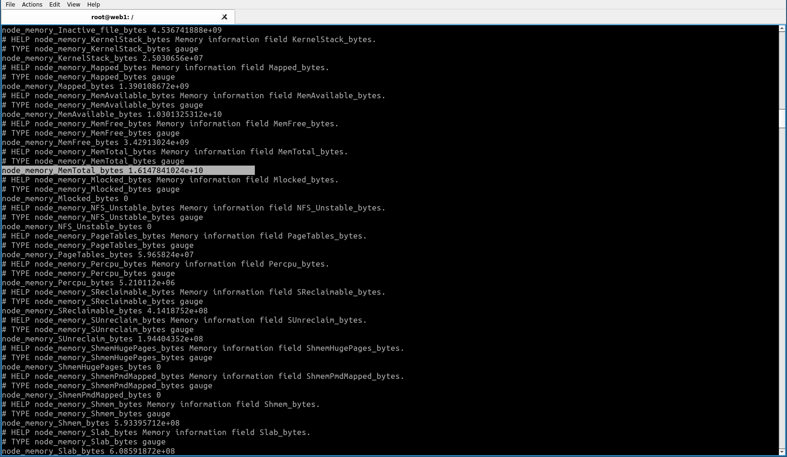
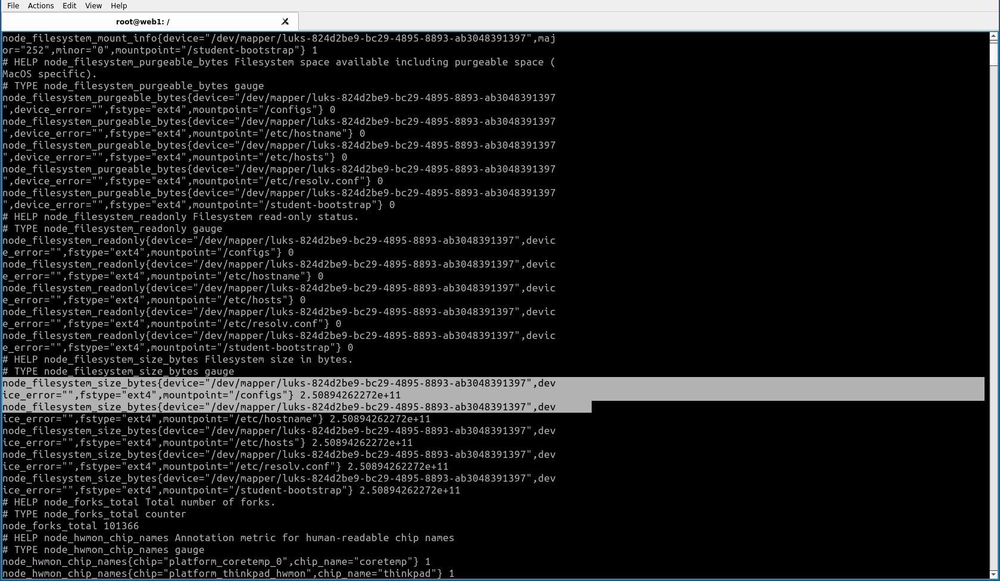
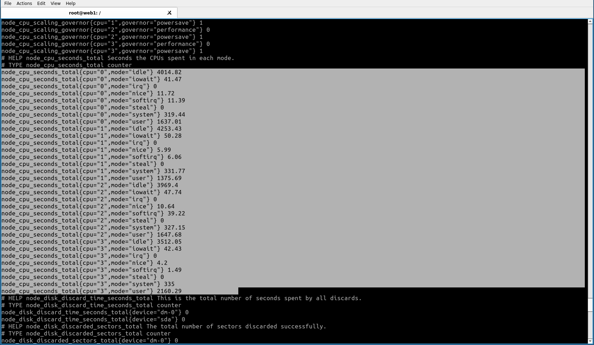
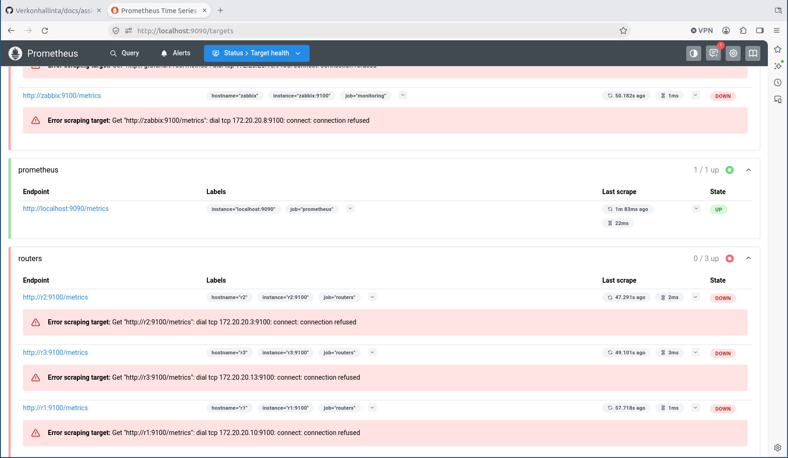
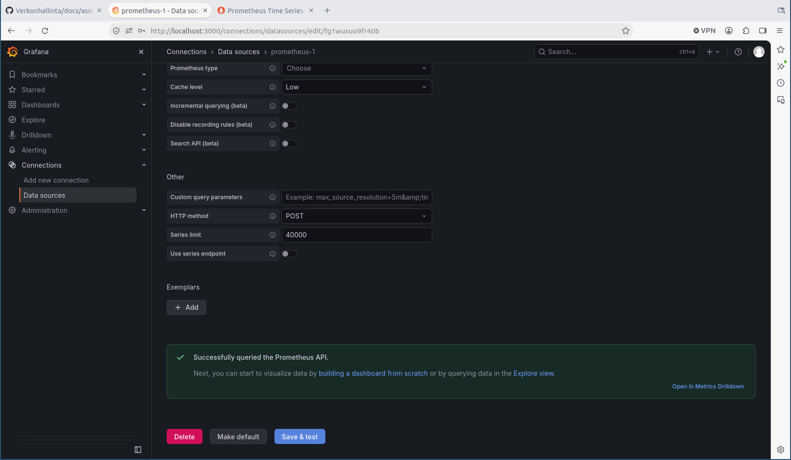
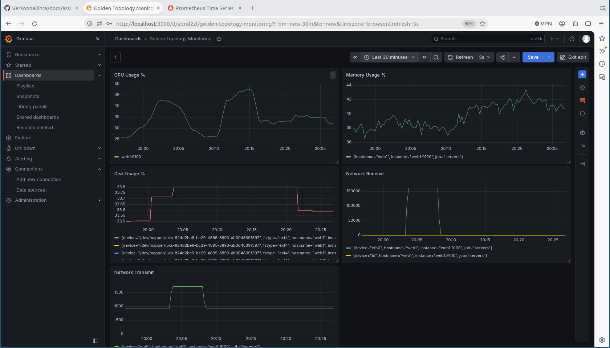

## 1. Johdanto 

Harjoituksessa verkon valvontaan käytettiin Prometheus-ekosysteemiä, joka ei ole yksittäinen sovellsus vaan enemmänkin ketju. Prometheus- ja Grafana työkalujen avulla pyritään keskittämään verko palvelujen monitorointi yhdelle alustalle. Esim. Grafanan Dashboard-ympäristöön. Monitoroinnin kohteena voi olla esim. suorittimen käyttöaste, keskusmuistin käyttö, verkkoliikenne jne. Näillä työkaluilla/teknologioilla on mahdollista monitoroida useampaa parametria/metriikkaa samanaikaisesti ja siten yhdistää samanaikaisia muutoksia, josta voi olla merkittävää apua vianetsinnässä.  


Monitoroinnilla tarkoitetaan verkon toiminnan (jatkuvatoimista) seuraamista ja nykytilanteen vertaamista historiaan. Monitoroinnin kohteena voi olla esim. verkkoliikenteen, palvelimen suorittimen ja keskusmuistin kuormitusta. Monitoroinnilla pyritään havaitsemaan haitallisia poikkeamia tai trendejä ja reagoimaan niihin korjaavasti, ennen kuin verkon käyttäjä havaitsee ongelmia ja antaa siitä palautetta.   

## 2. Node Exporterin käyttöönotto

Node-exporter otettiin käyttöön web1-palvelimelle. Käyttöönotto aloitettiin kirjautumalla web1-palvelimelle komennolla:

```bash
docker exec -it clab-hamk-verkonhallinta-golden-web1 bash 
``` 
Kirjautumisen jälkeen päivitettiin palvelimen metatietokanta komennolla:  

```bash
apt update
```

Tämän jälkeen asennettin tarvittavia työkaluja: wget sekä tar komennolla:
 ```bash
apt install wget tar -y
```

tar on tiedostojen pakkaamiseen ja purkamiseen tarkoitettu ohjelma. wget on ohjelma, jolla voi ladata tiedostoja internetistä, esim. Githubista, kuten tässä harjoituksessa. 

Kun tarvittavat työkalut oli asennettu, selvitettiin Node Exporterin viimeisin versio Githubista. Uudet versiot päivittyvtä tänne:

```text
https://github.com/prometheus/node_exporter/releases/
```

Uusin Node Exporterin versio oli 1.12.1 ja se asennettiin komennolla: 
```bash
wget https://github.com/prometheus/node_exporter/releases/latest/download/node_exporter-1.12.1.linux-amd64.tar.gz
```

Kun tiedosto oli latautunut, purettiin se käyttämällä aiemmin asennettua tar-ohjelmaa:
```bash
tar xvf node_exporter-*.linux-amd64.tar.gz
```

 Lopuksi siirryttiin Node Exporter hakemistoon: 
```bash
cd node_exporter-node_exporter-1.12.1.linux-amd64
```

Ja täräytettiin Node Exporter käyntiin:
```bash
./node_exporter```
```
Exporterin toiminta tarkastettiin avaamalla uusi terminaali, kirjautumalla uudelleen  web1-palvelimelle ja ajamalla komento: 

```bash
curl http://localhost:9100/metrics
```

Tuloksena oli mm. oheisten kuvien (Kuvat 1-3) mukainen pitkä tuloste. 



*Kuva 1. Kuvakaappaus web1-palvelimen terminaalista, komnennon curl http://localhost:9100/metrics tuloksesta, jossa Exporterista löydetty node_memory_MemTotal_bytes*



*Kuva 2. Kuvakaappaus web1-palvelimen terminaalista, komennon curl http://localhost:9100/metrics tuloksesta, jossa Exporterista löydetty node_filesystem_size_bytes*



*Kuva 3. Kuvakaappaus web1-palvelimen terminaalista, komennon curl http://localhost:9100/metrics tuloksesta jossa Exporterista löydetty node_cpu_seconds_total*


## 3. Prometheus

Prometheuksen toiminta tarkastettiin alkuun selaimessa osoitteessa: http://localhost:9090. Valiten sieltä Status ja Targets. Tällöin web1-palvelin näkyi kohteena ja sen tila oli "UP" (Kuva 4).


*Kuva 4. Kuvakaappaus Prometheuksesta selaimessa, jossa varmistettiin sen toiminta. Kuvassa näkyy web1-palvelin kohteena (target) sekä sen tila (state) "UP".*

Kun Prometheuksen toiminta oli varmistettu kirjauduttiin Grafana-alustalle ja listättiin tietolähteeksi Prometheus. Palvelimen osoitteeksi asetettiin http://prometheus:9090. Tämän jälkeen toiminta varmistettiin testaamalla yhteys ja yhteys toimi ensimmäiselllä yrittämällä (Kuva 5).



*Kuva 5. Kuvakaappaus Grafanasta, jossa näkyy, että yhteys(kysely) Prometheukseen toimii "Successfully queried Prometheus API".*

Tämän jälkeen luotiin Dashboard-ympäristö Grafanaan, johon lisättiin verkon toiminnan seurannan kannalta keskeisiä parametrejä. Parametrit lisättiin hyödyntäen PromQL-kyselyitä seuraavasti:

web1-suorittimen (CPU) käyttöä:

```bash
100 - (avg by(instance) (rate(node_cpu_seconds_total{mode="idle"}[5m])) * 100)
```

jolla pyydettiin web1-palvelimen suorittimen keskimääräistä käyttöastetta prosentteina viimeisen viiden minuutin aikana. Komento laskee täyden kapasiteetin (100) ja hyödyntämättömän kapasiteetin (idle) välisen erotuksen prosentteina.   

```bash
(node_memory_MemTotal_bytes - node_memory_MemAvailable_bytes)/node_memory_MemTotal_bytes* 100
```
jolla pyydettiin keskusmuistin hetkellistä käyttöastetta prosentteina. Huom. tästä puuttuu keskiarvoistameinen "avg" kuten CPU-komennossa.   


```bash
100 - node_filesystem_avail_bytes / node_filesystem_size_bytes * 100)
```
jolla pyydettiin tietoa web-1 palvelimen käytettävissä olevasta levytilasta. 

Sekä lopuksi vielä saapuvaa verkkoliikennettä kuvaava:

```bash
rate(node_network_receive_bytes_total[5m])
```
jolla saadaan tietoa web1-palvelimen saapuvasta verkkoliikenteen nopeudesta(rate) viimeisen viiden minuutin aikana tavuina (bytes)/sekunti. 

ja lähtevää verkkoliikennettä kuvaava:
```bash
rate(node_network_transmit_bytes_total[5m])
```
jolla saadaan tietoa web-1 palvelimelta lähtevästä verkkoliikenteen nopeudesta (rate) viimeisen viiden minuutin aikana tavuina (bytes)/sekunti. 

## 4. Dashboard
Edellisessä kappaleessa kerrottujen PromQL-kyselyiden avulla luotiin Grafanassa Dashboard, jonka eri paneeleissa  monitoroitiin web1-palvelimen seuraavia metriikoita: CPU Usage %, Memory Usage %, Disk Usage %, Network Receive, Network Transmit (Kuva 6). 




*Kuva 6. Kuvakaappaus Grafanan Dashboardista. Kuvassa CPU Usage % kuvaa web1-palvelimen suorittimen keskimääräistä käyttöastetta viimeisen viiden minuutin aikana, Memory Usage % kuvaa keskusmuistin hetkellistä käyttöastetta, Disk Usage % kuvaa levytilan käyttöastetta, Network receive kuvaa palvelimelta lähtevän verkkoliikenteen keskimääräistä nopeutta viimeisen viiden minuutin aikana ja Network transmit palvelimelta lähtevän verkkoliikenteen keskimääräsitä nopeutta viimeisen viiden minuutin aikana. Kaikkien käyrien aika-akseli (x-akseli) on 30 min. Käyreien kuormitustesteistä johtuvat vaihtelut on kuvattu kappaleessa 5.*

 

## 5.  Kuormitustesti
Kuortmitustestit web1-palvelimen terminaalissa toteutettiin  seuraavasti:


Levykuormitusta aiheutettiin ajassa 19:57 ajamalla komento:
```bash
dd if=/dev/zero of=testfile.img bs=1M count=500
```
CPU-kuormitusta aiheutettiin ajassa 19:58 ajamalla komento:

```bash
yes > /dev/null
```

Näiden kahden komentojen seuraukset näkyvät nousuun lähtevinä käyrinä Grafanan CPU-usage %- ja ja Disk Usage %-paneeleissa (Kuva 6).
CPU-usage saavutti huippulukeman 42,6% ajassa 20:02, jonka jälkeen se lähti laskkun, saavuttaen alimman pisteen 26,0% ajassa 20:09 (Kuva 6). Viiveet kuormituksen kasvussa ja laskussa johtunevat siitä, että Dashboardiin oli PromQL-kyselyllä pyydetty viiden minuutin keskiarvo suorittmien käyttöasteesta. 


 Disk usage sasaavutti huippulukemansa 33,8%, johon tasaantui ajassa 20:04 (Kuva 6). Tämä tarkoittanee, että tiedosto oli valmiiksi kirjoitettu 20:04. Myöhemmin, ajassa 20:21 poistin kokeilumielessä tiedoston komennolla:

```bash
rm testfile.img
```
Tiedoston poiston seurauksena levykuormitus lähti laskuun (Kuva 6, ajassa 20:21 eteenpäin). 

CPU- ja levykuormituksen aiheuttamisella ei ollut vaikutusta verkkoliikenteeseen. Kuvassa 6  20:03 alkaen näkyvä verkkoliikenne (Network receive ja Network transmit paneelit) aiheutuivat siitä, kun asensin stress-ng ohjelman. Ajassa 20:03 ajoin asennuskomennon:

```bash
apt install stress-ng -y 
```

Asennuksen jälkeen aiheutettiin CPU-kuormitusta ohjelmalla stress-ng ajassa 20:10 komennolla:
```bash 
stress-ng --cpu 4 --timeout 60s
```
Tämän seurauksena CPU-usage lähti nousuun ja saavutti huippuarvonsa (47.6%) ajassa 20:15, mikä on n. 5 minuuttia komennon ajamisen jälkeen. Oletin, että testi olisi kestänyt 60 s. Tämän testin jälkeen CPU usage vakiintui tasolla 32-33%, mikä on korkeampi perustaso, kuin lähtötilanteessa ennen komennon ajamista (Kuva 6).


## 6. SNMP vs Prometheus

1. Mitä hyötyä Prometheuksesta on verrattuna SNMP:hen?
- Prometheus-ekosysteemin käyttö verkonvalvonnassa tarjoaa mahdollisuuden kerättyjen tietojen visualisointiin aikasarjojen muodossa, mikä helpottaa muutosten ja muutoshistorian seurantaa reaaliajassa. Prometheuksen käyttö mahdollistaa myös useamman verkon toimintaan vaikuttavan parametrin seuraamista. Tämä helpottaa samanaikaisten tapahtumien yhdistämistä ja siten helpottaa vianetsintää ja nopeuttaa korjaavien toimenpiteiden toteutusta. 

2. Millaisia mittareita ylläpitäjän kannattaa seurata jatkuvasti?
Ylläpitäjän kannattaa seurata harjoituksessa tarkasteltuja mittareita (Levytilan, keskusmuistin ja CPU:n kuormitusta). Näiden lisäksi erilaiset häiriöitä indikoivat mittarit voivat olla hyviä seurata jatkuvasti.

3. Mitä tietoa dashboardisi tarjoaa ylläpitäjälle?
Dashboard tarjoaa visuaalista ja helposti hahmotettavaa tietoa web1-palvelimen suoritimen (CPU), keskusmuistin (Memory), ja levytilan (Disk) kuormituksesta sekä verkkoliikenteestä (Networ receive ja Network Transmit). Visuaalinen informaatio voi olla helpommin lähestyttävää, kuin tekstipohjainen tieto. 
4. Mitä uusia mittareita lisäisit dashboardiin?
System uptime, eli kuinka pitkään palvelin on ollut käynnissä sekä Network erros. Verkkoliikenteessä tapahtuvien virheiden määrä.
5. Miten monitorointitiedosta voisi olla hyötyä vianetsinnässä?
Aikasarjoista voi olla apua vianetsinnässä, kun pystytään määrittämään häiriön ajankohta ja kauanko häiriö on jatkunut. 


*Taulukko 1. SNMP vs. Prometheus vertailu.*
 Ominaisuus                     | SNMP                                                  | Prometheus                                             |
| ------------------------------ | ----------------------------------------------------- | ------------------------------------------------------ |
| Tiedonkeruu                    | Kyselypohjainen                                        | HTTP-pohjainen                                         |
| Käyttöönotto                   | Vaatii SNMPn konfiguraation ja  määrittelyn            | Vaatii Prometheus-palvelimen ja Node exporterin        |
| Mittarien määrä                | Voidaan määrittää MIB-määrityksistä                    | Määriteltävissä PromQL-kyselyillä                      |
| Visualisointi                  | Ei taida löytyä vakiona                                | Onnistuu Grafanan Dashboard-ympäristössä (PromQL avulla|
| Hälytysmahdollisuudet          | SNMP-trapit                                            | Alertmanager                                           |
| Soveltuvuus pilviympäristöihin | Soveltuu rajallisesti                                  | Soveltuu hyvin                                         |


## 7. Yhteenveto

Tämä harjoitus oli kurssin aiempiin harjoituksiin verrattuna selkeämpi ja suoraviivaisempi. Github-ympäristössä olleita suoritusohjeita seuraamalla kaikki onnistui lähestulkoon kerralla, eikä ohjeistuksen ulkopuolista säätämistä teknologioiden tomimiseksi tarviinut tehdä. Esimerkiksi SNMP:hen verrattuna Prometheus tuntui enemmän "avaimet käteen"-periaatteella toimivalta ratkaisulta, koska asentaminen ja käyttöönotto oli melko suoraviivaista. SNMP:hen verrattuna Prometheuksen kanssa ei tarvinnut muokata konfiguraatiotekstitiedostoja tai ajaa useita bash-komentoja homman toimimaan saamiseksi. 

Haasteita Prometheuksen kanssa voi tulla siinä miten ja mitä monitoroitua dataa tallennetaan. Trendien tunnistamiseksi olisi hyvä tallentaa pidemmän aikavälin dataa, mutta se ei aina liene mielekästä. Myös tallennusvälin (intervalli) valinta voi tuottaa haasteita, jos halutaan seurata pidemmän aikavälin trendejä esim. palvelinliikenteen kasvua, mutta myös tunnistaa reaaliaikasesti poikkeavuuksia.  

Prometheus sovletuu erityisen hyvin sellaisiin järjestelmiin, joissa on tarvetta realiakaiseen verkkoliikenteen, verkontoiminnan ja resurssien käytön seurantaan ja joissa on tarvetta seurata useampaa parametria samanaikaisesti. Prometheus soveltuu myös hyvin pilviympäristöihin.


