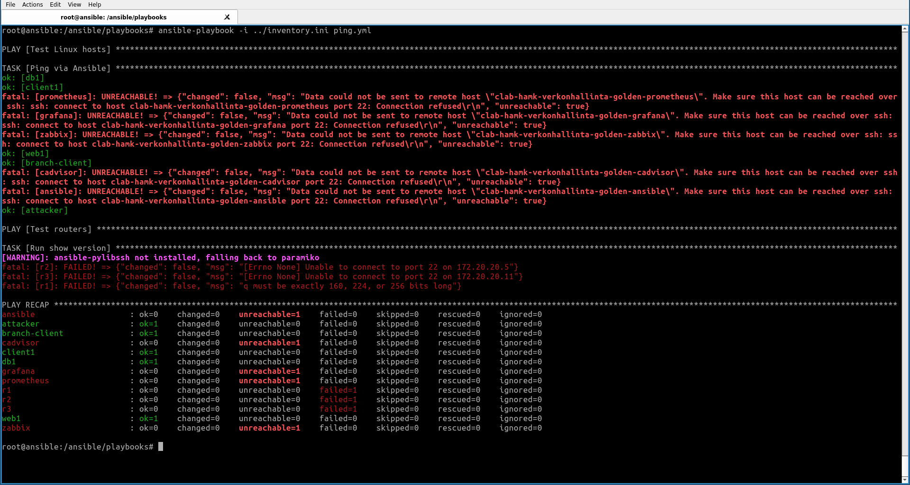

## 1. Johdanto

Selitä Infrastructure as code (IaC). 

Perusajatus on, että hallitaan tavoitetilaa, ei yksittäisiä komentokertoja. Toisin sanoen hallitaan laajempaa infrastruktuuria koodin avulla sen sijaan, että palvelimien ja muiden laitteiden asetuksia ja määrityksiä tehtäisiin käsin.  Infrastruktuurin määritykset ovat luettavaa, toistettavaa ja versiohallittavaa aineistoa. IaC:n etuna on prosessien automatisointi, toistettavuus ja versionhallinta. IaC periaatteella toimiminen on myös nopeampaa ja vähemmän virhealtista, kuin esim. palvelinmääritysten tekeminen käsin. 
## 2. Inventory


Inventory saatiin näkyville ajamalla ansible-palvelimella bash-terminaalissa komento:

```bash
cat /ansible/inventory.ini
```
Tuloksena oli inventory, josta löytyi Taulukon 1 mukaiset laitteet ryhmiteltynä.

*Taulukko 1. Inventoryn ryhmät sekä ryhmiin kuuluvat laitteet*
 
| Ryhmä     | Laitteet
|-----------|---------------------------------------|
| routers   | r1, r2, r3                            |
| clients   | client1, attacker, branch-client      |
| servers   | web1, db1                             |
| monitoring| prometheus, grafana, zabbix, cadvisor |
| management| ansible                               |

Ryhmät ovat muodostettu laitteiden käyttötarkoituksen mukaan. Esim. routers, clients servers. Toisaalta löytyy myös ryhmittelyä sen mukaan missä verkossa laitteet ovat (Network segment) ja mihin infrastruktuurin ryhmään (infrastructure group) laitteet kuuluvat. Eri ryhmittelyt auttavat tunnistamaan minkä tyyppisiä laitteita verkkoympäristössä on sekä myös tunnistamaan missä verkkotopologian osassa laitteet ovat. 


Seuraavaksi tarkistettiin yhteydet ajamalla komento:
```bash
ansible all -i /ansible/inventory.ini -m ping
```
Ansible-palvelimelta sai kaikkiin kolmeen reitittimeen (r1, r2, r3).

r3 | SUCCESS => {
    "changed": false,
    "ping": "pong"
}
r1 | SUCCESS => {
    "changed": false,
    "ping": "pong"
}
r2 | SUCCESS => {
    "changed": false,
    "ping": "pong"
}

Muiden laitteiden kohdalla luki "UNREACHABLE". 


Ensimmäistä palybookia yritettiin asentaa siirtymällä ensin playbook-hakemistoon komennolla:
```bash
cd /ansible/playbooks
```
ja ajamalla komento
```bash
ansible-playbook -i ../inventory.ini ping.yml
```
Tämän seurauksena ei vielä tapahtunut mitään, koska muihin verkon laitteisiin ei saatu yhteyttä, vaan niistä tuli herjaukset "UNREACHABLE". Sekä toinen herja "[WARNING]: ansible-pylibssh not installed, falling back to paramiko". 

Nämä ongelmat korjattiin laittamalla ssh yhteydet laitteilla päälle. Esimerkiksi web1-palvelimella ensin kirjautumualla palvelimelle ja ajamalla komento:
``` bash
service ssh start
```
Sama toimenpide tehtiin muillekin laitteille. Tämän jälkeen asennettiin paramiko ansible-palvelimelle. Ensin kirjauduttiin ansible-palvelimelle ja sen jälkeen ajettiin
```bash
apt update
apt install python3-paramiko 
```
Tämän jälkeen ajettiin playbook ping.yml, jonka tarkoituksena on testata yhteyksiä Ansiblen ja muiden verkon laitteiden välillä. Playbook pingaa kaikkia linux_hosts ryhmän laitteita ja testaa yhteyksiä reitittimiin (ryhmä routers) kysymällä reitittimen versiota. 

Laitteiden web1, db1, client1, branch-client ja attacker yhteystestit onnistuivat. grafana, prometheus, zabbix, cadvisor ja ansible yhteystestit eivät onnistuneet. Näissäkin saattoi olla sama ongelma, eli SSH palvelin ei ollut päällä. Koska näitä laitteita ei mainittu myöhemmissä harjoituksen vaiheissa, en lähtenyt muuttamaan niiden asetuksia. 

Myös reitittimien yhteystestit epäonnistuivat. r1 epäonnistumisen syy poikkeaa r2 ja r3 (Kuva 1), sillä yritin saada r1 ssh-yhteyttä toimimaan (Chat GPT avustamana), mutta luovutin, koska tulkitsin harjoituksen ohjeita niin, että yhteyksille ansible-palvelimelta reitittimelle ei ollut tarvetta. 


*Kuva 1. Tuloste ping.yml playbookin ajamisesta. Kuvassa näkyy yhteystestien tulokset eri laitteille.* 

## SNMP Playbook


## 4. Node Exporter Playbook

## 5. Vertailu


## 6. Yhteenveto
